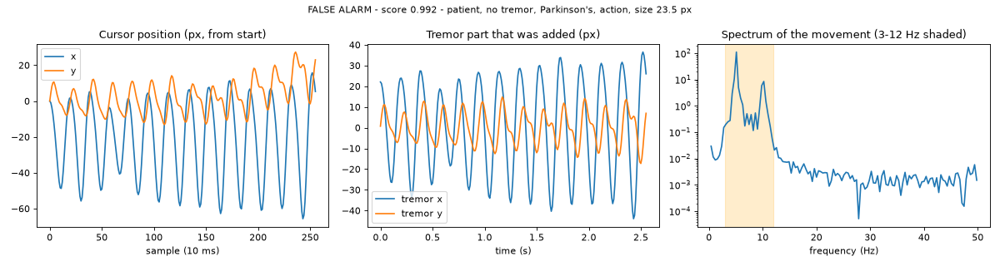

# TAG Pointer

**Track:** Health
**Team:** Names on the submission form

**This project is a prototype and is not medical advice.**

## The problem

Controlling a computer mouse may be challenging for someone with Parkinson's disease or essential tremor who uses a laptop at home owing to the involuntary hand movements that make clicking a checkbox, closing a window or selecting a small target difficult. Conventional filtering methods often trade-off diminished tremor for responsiveness which may make precise digital interaction difficult.

## What we built

TAG-Pointer is a mouse stabilisation tool based on a trained model that understands tremors. Users move the mouse as usual, yet the system detects involuntary tremor-like motion and corrects the pointer trajectory in real time.

## What we added

Our own idea. We also developed Click Freeze, which improves click performance with strong simulated tremor, session performance summaries, and local-only tracking for privacy. The assistant sees only summary statistics, never raw mouse movement.

## How it works

**Data:** Tremor data from public sources (PADS/TremorDB) and synthetic mouse data. As there is no publicly available data that can be directly used in this scenario, real-world tremor data from wrist/fingertips was mapped to simulated mouse. The recordings come from 484 people (PADS 469, TremorDB 15), split by person: 340 for training, 72 for choosing settings and 72 for the final test, so test people were never seen in training.

**Detection:** Gradient boosting identifies likely tremor motion from 19 explainable traits of the past 2.56 seconds.

**Correction:** A neural network uses the previous 0.64 seconds of cursor movement to estimate and remove tremor. Rather than the Corrector modifying all mouse movements, the Corrector is activated/deactivated by Detector v2.

**Application:** Real time pointer smoothing, Click Freeze, session analytics and AI assistant.

## Results

All results are on the 72 test people.

### 1. Tremor Detection Model

**Table 1: Detector comparison**

| Detector | Missed cases | False alarms | Accuracy |
|---|---|---|---|
| Always no tremor | 100.0% | 0.0% | 74.5% |
| Frequency rule | 14.8% | 59.0% | 52.3% |
| Detector v1 | 14.3% | 27.0% | 76.2% |
| Detector v2 | 12.9% | 27.1% | 76.5% |

Across groups it is close: missing cases were 12.9% under 60, 12.7% at 60 to 69 and 13.2% at 70 and over; 10.4% for women and 14.8% for men. With 72 test people the 95% range for missed cases is 9.7% to 18.4%.

There are several crucial aspects where we think TAG missed:

- Small tremor is missed: 34.2% of tremor under 3 px, against 2.9% over 10 px. It is hidden under deliberate movement tens of pixels large.
- Some "false alarms" look exactly like tremors. They are 41.7% on tasks where the patient moved on purpose, against 19.5% at rest; our labelling rule probably left real tremor unmarked there. The chart shows the most confident one, a strong, regular 5 Hz shake.



### 2. Tremor Correction Model

**Table 2: Quantitative evaluation**

| Evaluation Metric | No Filter | Lower Sensitivity | One Euro | TAG Pointer |
|---|---|---|---|---|
| Distance from intended path (moving / still, px) | 13.17 / 12.74 | 6.59 / 6.40 | 15.32 / 6.98 | 7.32 / 4.29 |
| Tremor removed (%) | 0% | 75% | 49% | 88% |
| Jerkiness (px) | 1.69 | N/A | 0.98 | 1.27 |
| Simulated click success (strong tremor, 10 px target) | 24% | N/A | 88% | 99% |
| Processing latency (ms) | 0 | 0 | 20 | 0 |

The rows above measure our network alone. In the app its output is also smoothed: the cursor then shakes less than with One Euro (2.56 vs 3.39 px), but trails a moving hand by 72 ms. The click test is a simulation with perfect aim; by hand, real buttons were still harder to hit.

TAG-Pointer removes more tremor and stays closer to the intended path than traditional methods, but the network alone is less smooth than One Euro. Compared to the One Euro filter, we achieved a relative improvement of approximately (88% - 49%) / 49% = 79.6% in removing the tremor. One Euro is a low-pass filter whose cut-off changes with movement speed, trading jitter against lag (Casiez et al., 2012). Our network instead uses the last 0.64 seconds of motion to estimate the tremor component and subtract it, rather than just filtering harder.

**Table 3: Cases where TAG underperforms traditional methods**

| Area/Feature | TAG-Point vs One Euro | Interpretation |
|---|---|---|
| Jerkiness (network alone) | 1.27 vs 0.98 | One Euro smoother |
| Still hand, mild tremor in demo | 0.43 vs 0.29 px | One Euro better when the hand is still and tremor is mild |
| Reaching, mild tremor in demo | 6.53 vs 7.04 px (no filter 1.55) | The smoothing lags, so both filters do worse than no filter |
| Lag while reaching | 72 ms (app, Steadiest) vs 20 ms (Table 2) | One Euro follows the hand faster |

We did not measure the average time taken to complete tasks as TAG's performance also depends on the severity of the tremor. Oftentimes with mild tremor it will be much harder to detect and correct. Therefore TAG should be used as a complementary method.

## What we'd do next

- Test it with people who have tremor. Nothing we measured replaces real-world testing with intended users.
- Retrain the detector to be stricter during fast, deliberate movement, where most false alarms happen. Changing the cut-off alone did not help; we tried it.
- Test sudden direction changes to determine whether the corrector introduces lag or incorrectly suppresses intentional movement when users change direction rapidly.
- Test irregular tremor patterns to evaluate whether the model can reliably distinguish tremor from intentional movement when tremor frequency and amplitude vary.

## Run it

```bash
python3.12 -m venv .venv && source .venv/bin/activate
python -m pip install -r requirements.txt
python -m uvicorn server.main:app          # then open http://127.0.0.1:8000
```

No dataset download is needed to run the app. The assistant needs an Anthropic API key in a `.env` file; without one it shows a plain summary instead.

## Bibliography

The full list of sources, with licences, is in [SOURCES.md](SOURCES.md).

**AI tools:** Claude Code (code development and testing); Claude API (AI assistant in the product)

**Datasets:** PADS, Parkinsons Disease Smartwatch dataset v1.0.0, PhysioNet, https://doi.org/10.13026/m0w9-zx22 (CC BY-NC-SA 4.0). Effect of Deep Brain Stimulation on Parkinsonian Tremor (TremorDB), PhysioNet, https://doi.org/10.13026/C2D097 (ODC-By 1.0).

**Pretrained model:** None. Both models were trained by us.

**AI service in the product:** Claude API (Anthropic), model claude-sonnet-5-5, https://docs.claude.com.

**Libraries:** NumPy, pandas, SciPy, scikit-learn, Matplotlib, PyTorch, FastAPI, Uvicorn, Anthropic Python SDK, python-dotenv, certifi, pytest, PyObjC, ui-sdk web components.

**Methods:** One Euro filter, used as a baseline: Casiez, G., Roussel, N., & Vogel, D. (2012). 1€ Filter: A Simple Speed-based Low-pass Filter for Noisy Input in Interactive Systems. CHI 2012. https://github.com/casiez/OneEuroFilter. Gradient boosting (Friedman, 2001); dilated causal convolutions (van den Oord et al., 2016, arXiv:1609.03499); related work on tremor in cursor movement (White and Horvitz, 2019, https://doi.org/10.1038/s41746-019-0171-4).
